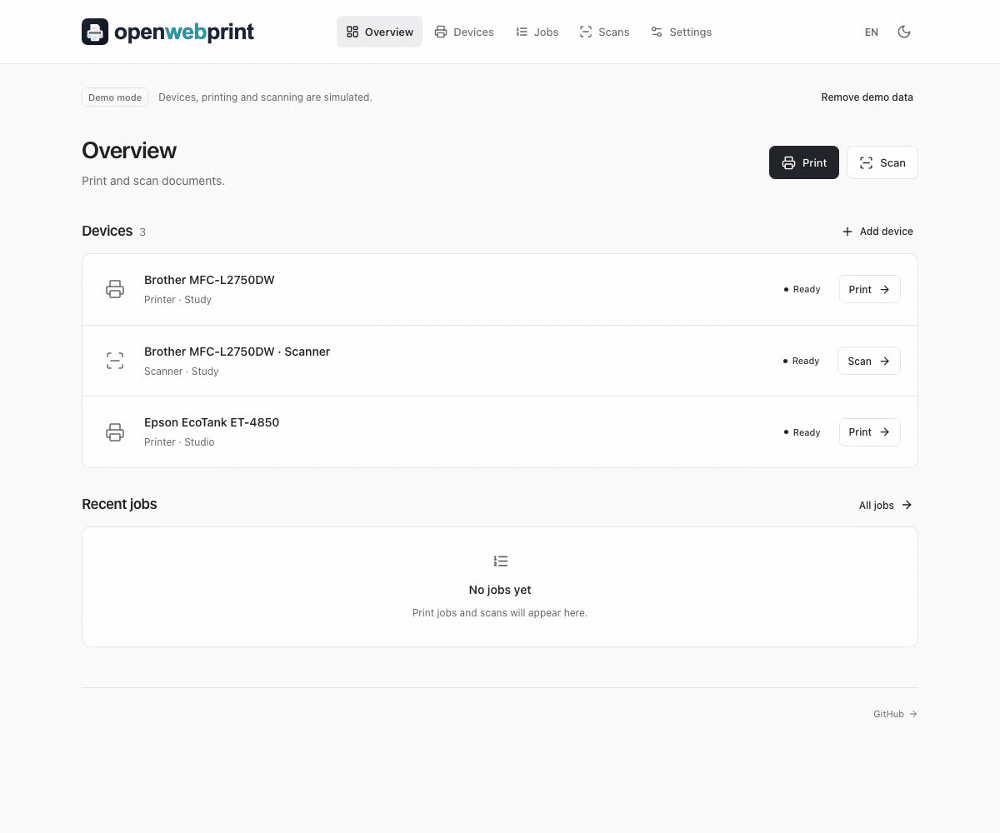
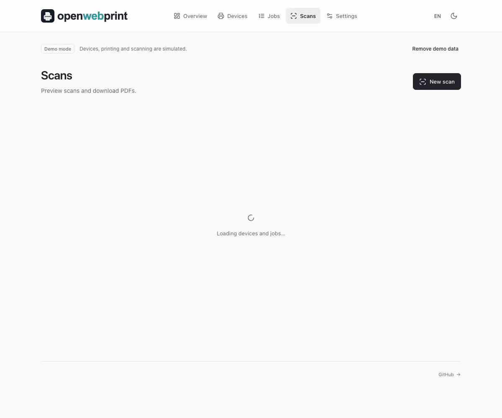

<div align="center">

<h1>
  <picture>
    <source media="(prefers-color-scheme: dark)" srcset="apps/client/public/openwebprint-logo-dark.svg" />
    
  </picture>
</h1>

**Your paper. Your workflow. Your server.**

Print and scan from your browser, without another manufacturer app.
Open source, self-hosted, and built around open standards.

[](https://github.com/Florian-Cullmann/openwebprint/actions/workflows/ci.yml)
[](LICENSE)
[](https://nodejs.org/)

[Get started](#quick-start) · [See it in action](#see-it-in-action) · [Self-hosting](#self-hosting) · [Hardware compatibility](docs/hardware.md#supported-protocols) · [Contribute](CONTRIBUTING.md)

</div>

## See it in action

One browser workspace for your printers, scanners, and documents. **Self-hosted,
with no cloud account, telemetry, or subscription.** Available in English and
German, with desktop/mobile layouts and light/dark themes.

These recordings show the **actual application in demo mode**. Printing and scanning
are simulated; no physical hardware was used. Clips play once to keep this page
quiet. Open a clip and reload to replay, or follow the static alternatives below.

### Print with confidence



Upload → preview → choose pages and sides → follow the job.
Accepts PDF, PNG, or JPEG files up to 25 MiB; available options depend on the printer.
[Static print view](docs/images/demo-print-still.png) · [Open animation](docs/images/demo-print.gif) · [Printing guide](docs/usage.md)

### Turn paper into a useful PDF



Scan → add a page → rotate and reorder → download one PDF.
Collect up to 100 pages, with cropping and flatbed/feeder options where supported.
[Static scan view](docs/images/demo-scan-still.png) · [Open animation](docs/images/demo-scan.gif) · [Scan editing and export](docs/usage.md)

### Keep your documents within reach

Search saved scan titles, preview documents, download PDFs or a ZIP of selected
scans, and print retained documents again. Files expire after **seven days by
default**, configurable in Settings. [Explore the workspace](docs/images/overview.png)
or read the [usage guide](docs/usage.md).

Ready to try it? [Get started below](#quick-start) and choose **Try demo**; no
printer or scanner is needed. **Hardware mode never falls back to simulation.**

This README describes the current `main` branch. The latest packaged release is **[v0.1.0-beta.3](docs/releases/v0.1.0-beta.3.md)**. Hardware compatibility depends on device protocols and host drivers; see the [hardware guide](docs/hardware.md).

## Quick start

### Install for everyday use

**Linux and macOS** packages include the production application and a private Node.js runtime, plus a browser launcher and startup at login. No Git, npm, system Node.js, or Docker is required. CUPS/SANE and any required device drivers are separate.

Paste into Terminal as your normal user, **without sudo**:

```sh
curl -fsSL https://github.com/Florian-Cullmann/openwebprint/releases/download/v0.1.0-beta.3/install.sh -o install-openwebprint.sh
OPENWEBPRINT_VERSION=v0.1.0-beta.3 sh install-openwebprint.sh
```

Open **http://127.0.0.1:3001**, then choose **Try demo** or **Start setup**. The commands pin the published beta explicitly. See the [installation guide](docs/installation.md) for supported OS versions, hardware prerequisites, updates, backups, logs, and uninstall.

**Windows is currently unsupported**, including installation, printing, and scanning. Follow [#14](https://github.com/Florian-Cullmann/openwebprint/issues/14) for progress.

### Run from source (development)

Requires **Node.js 24 LTS or 26** and npm. SQLite is built into Node; no database service is needed.

```sh
git clone https://github.com/Florian-Cullmann/openwebprint.git
cd openwebprint
npm ci
cp .env.example .env
npm run dev
```

Open **http://localhost:5173** and choose a setup method. Use **Remove demo data** to leave the demo and connect real devices. See [CONTRIBUTING.md](CONTRIBUTING.md) for checks, architecture, and development conventions.

### Try it with Docker

```sh
docker compose --profile demo up --build -d
```

Open **http://localhost:3001** and choose a setup method. The `demo` profile uses bridge networking; the browser choice determines whether devices are simulated. Data persists in named volumes. For Linux hardware networking, macOS discovery, production configuration, and stopping the instance, see [self-hosting](docs/self-hosting.md).

## Screenshots

Prefer still images? Browse the [workspace overview](docs/images/overview.png),
[print preview](docs/images/demo-print-still.png), and
[scan editor](docs/images/demo-scan-still.png). All use synthetic demo content.
See [README media maintenance](docs/readme-media.md) for recording instructions,
format choices, and asset sizes.

## Self-hosting

Use the [self-hosting guide](docs/self-hosting.md) for production source deployments, Docker profiles, environment variables, HTTPS, storage, retention, backups, and access recovery.

**New installations have no login until you add a user.** Everyone who can reach an instance without users has full access. Add a user under **Settings → Users** before exposing it beyond a trusted environment. All users have administrator permissions and share access to documents; per-user isolation is not implemented. Keep hardware daemons private and use HTTPS with secure cookies for network access. See the [security policy and trust model](SECURITY.md).

## Hardware support and honest limits

- **Printing uses CUPS; scanning uses SANE**, including eSCL/WSD through sane-airscan where available. Older devices may need separately installed drivers. The app and bundled hardware stack are open source; proprietary vendor drivers are not bundled.
- **Compatibility is model-specific.** Real discovery and printing have been confirmed for a Brother DCP-L2620DW; physical scanning for that model remains unconfirmed. See [hardware validation](docs/hardware.md#hardware-validation) and report your own results. Demo devices and automated tests do not certify hardware.
- **Job status reflects the backend.** Reported completion does not prove physical paper output. Unknown outcomes remain unconfirmed, and failed submissions are never automatically retried. Check the printer before reprinting.
- **Current limits:** no OCR, cloud relay, printer firmware management, ink-level estimates, remote CUPS authentication, or import of jobs submitted outside the app. PDF uploads are rebuilt with forms flattened and annotations omitted; signatures are not validated. Upload trusted documents.

## Documentation and contributing

| Guide                                | Contents                                                               |
| ------------------------------------ | ---------------------------------------------------------------------- |
| [Installation](docs/installation.md) | Linux/macOS packages, hardware setup, updates, logs, removal           |
| [Using openwebprint](docs/usage.md)  | Printing, scan editing and export, history, notifications, accounts    |
| [Self-hosting](docs/self-hosting.md) | Source/Docker deployments, configuration, HTTPS, storage, recovery     |
| [Hardware](docs/hardware.md)         | Protocols, device setup, macOS discovery, diagnostics, troubleshooting |
| [Contributing](CONTRIBUTING.md)      | Development, checks, architecture, screenshots, translations, PRs      |
| [Providers](docs/providers.md)       | Integration contracts and verification boundaries                      |
| [Security](SECURITY.md)              | Trust model and private vulnerability reporting                        |

You do not need to write code to help. Documentation improvements, translations,
bug reports, and hardware compatibility reports are welcome alongside code.
Tell us what you tried and what happened; for device reports, include the model,
host OS, and whether you tested discovery, printing, or scanning. Follow the [contribution workflow](CONTRIBUTING.md#required-workflow): use a dedicated branch and pull request, with an issue for features and larger changes. This project is not affiliated with printer or scanner manufacturers.

## License

[MIT](LICENSE). Bundled open-source components retain their own licenses. Printer names and trademarks belong to their respective owners.
