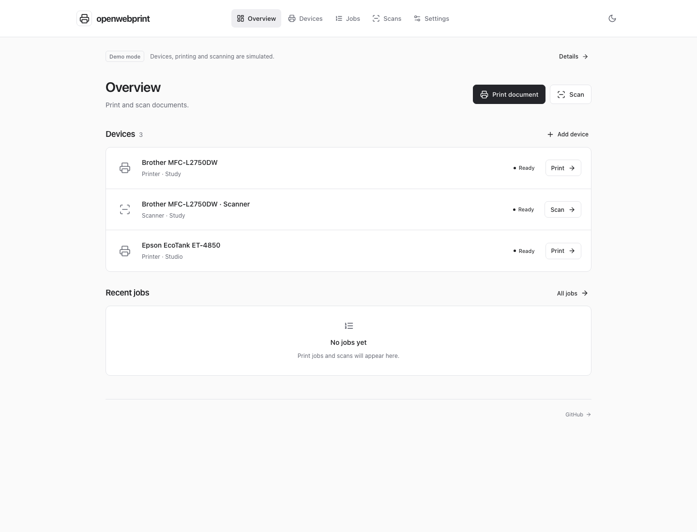
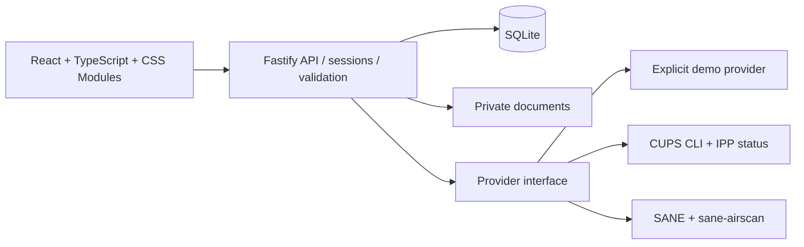

<div align="center">

# openwebprint

**Your paper. Your workflow. Your server.**

Print and scan from your browser, without another manufacturer app.
Open source, self-hosted, and built around open standards.

[](https://github.com/Florian-Cullmann/openwebprint/actions/workflows/ci.yml)
[](LICENSE)
[](https://nodejs.org/)

[Get started](#quick-start) · [Self-hosting](#self-hosting) · [Brother support](docs/hardware.md#brother-from-day-one) · [Contribute](CONTRIBUTING.md)

</div>



## A calmer way to work with paper

openwebprint puts your printers, scanners, and documents in one browser workspace. No cloud account, telemetry, third-party fonts, subscription, or vendor SDK. The web app and bundled hardware stack use open-source software. Some older devices may require a separately installed, potentially proprietary driver; those drivers are not bundled or required for driverless devices.

This is a working **v0.1 MVP**, with real CUPS and SANE integrations and a clearly labeled demo. Physical device compatibility still needs community testing. The interface and all application routes use English.

- **Find and connect devices:** mDNS IPP/IPPS discovery, existing CUPS queues, SANE detection, and manual setup.
- **Print documents:** validated PDF, PNG, and JPEG uploads, up to 25 MiB; copies, color, duplex, and supported paper sizes.
- **Scan a page:** 150/300/600 dpi, color or grayscale, image preview, and a real downloadable PDF.
- **Follow your work:** queued, processing, completed, canceled, failed, and explicitly unknown job states. Cancel active print jobs; delete completed records and scan files.
- **Feel at home:** responsive React interface, CSS Modules, dark/system mode, keyboard-accessible dialogs, optional user accounts, and protected sessions.
- **Develop without hardware:** deterministic demo devices including a Brother MFC-L2750DW printer/scanner pair. Demo labels remain visible throughout.

Demo print jobs never reach CUPS. Demo scans generate a sample document that explicitly identifies itself as simulated. **Hardware mode never falls back to demo behavior.**

## Quick start

Requires Node.js **24 LTS** (recommended) or 26 and npm. SQLite is provided by Node's built-in `node:sqlite`; no database service is required. Node 24 may print an experimental SQLite warning.

```sh
git clone https://github.com/Florian-Cullmann/openwebprint.git
cd openwebprint
npm ci
cp .env.example .env
npm run dev
```

Open **http://localhost:5173** and start using the app immediately. New installations have no users and do not show a login screen. The default mode is **demo** and does not require hardware tools.

Create users under **Settings → Users** (`/settings/users`). Adding the first user enables login immediately, including for the creator. All users can manage the instance and access its devices/documents. Removing the last user disables login again. Passwords must contain at least 12 characters. Existing accounts are preserved when upgrading; legacy sessions expire once during the database migration.

### Try it with Docker

```sh
docker compose --profile demo up --build -d
docker compose logs demo
```

Open **http://localhost:3001**; a fresh installation opens directly. The port is bound to loopback by default. Stop with `docker compose --profile demo down`. Named volumes retain accounts, devices, and job history.

## Self-hosting

### Production without Docker

```sh
npm ci
npm run build
# Load your deployment configuration, then:
node --env-file=.env apps/server/dist/index.js
```

Run from the repository root: Fastify serves the compiled React app and API on the same port. In production set `APP_ORIGIN=http://localhost:3001` for local HTTP, or your actual HTTPS origin behind a reverse proxy. Do not run the Vite development server as a production server.

### Real printers and scanners

For Linux, install CUPS, SANE, and sane-airscan, then set `MODE=hardware`. On Debian/Ubuntu:

```sh
sudo apt-get update
sudo apt-get install cups cups-client cups-filters sane-utils sane-airscan printer-driver-brlaser
```

The operating-system CUPS administrator must permit the application service user to manage queues, or create queues in CUPS first and import them as `cups://QUEUE_NAME`. Existing queues work without granting queue-creation rights. Do not weaken a shared CUPS server's authentication to match the dedicated container configuration.

For the bundled **Linux Docker** hardware stack:

```sh
# Stop the demo first: both profiles use port 3001.
docker compose --profile demo down
MODE=hardware docker compose --profile hardware up --build -d
docker compose logs hardware
```

The profile runs CUPS and Avahi inside the container and drops the web process to the unprivileged `node` user. It uses Linux host networking for mDNS/eSCL/WSD. Port 3001 and the dedicated CUPS scheduler (631) bind to loopback. **Do not run it alongside a host CUPS scheduler already listening on 127.0.0.1:631.** Use a native install instead, or stop the conflicting scheduler deliberately. Port 5353 may also conflict with another mDNS daemon. See [hardware networking and troubleshooting](docs/hardware.md).

Demo and hardware profiles have **separate volumes and user lists**, both initially empty. On a native installation, `MODE` is selected at startup; the database separates each mode's devices/jobs while sharing its users. Switching modes does not convert demo devices into real devices.

Docker Desktop on macOS/Windows does not reliably forward link-local discovery. Use manual IPP addresses and native SANE configuration, or run on a Linux host. USB passthrough is not configured by the Compose file. The native app can use devices already exposed by CUPS/SANE.

### Configuration

| Variable        | Default                 | Purpose                                                                                |
| --------------- | ----------------------- | -------------------------------------------------------------------------------------- |
| `MODE`          | `demo`                  | `demo` or `hardware`; never chosen by an HTTP request                                  |
| `HOST`          | `127.0.0.1`             | HTTP bind address; image defaults to `0.0.0.0`, hardware profile overrides to loopback |
| `PORT`          | `3001`                  | HTTP port                                                                              |
| `APP_ORIGIN`    | `http://localhost:5173` | Exact allowed browser origin; set to your deployed URL                                 |
| `DATA_DIR`      | `./data`                | SQLite, sessions, and private scan storage                                             |
| `COOKIE_SECURE` | `false`                 | Set `true` with HTTPS                                                                  |
| `CUPS_SERVER`   | `localhost:631`         | Local scheduler only: localhost, 127.0.0.1, or [::1], optionally with port             |

For LAN or internet access, put a reverse proxy on the same host in front of loopback port 3001, terminate TLS, set `APP_ORIGIN=https://print.example.org` and `COOKIE_SECURE=true`. The proxy must preserve the `Origin` header and allow uploads of at least 25 MiB plus multipart overhead. No CORS wildcard is used. Request limits use the direct peer IP; the app intentionally does not trust arbitrary forwarding headers. A shared proxy therefore shares rate limits.

For Docker, export those two variables or put them in the root `.env`; Compose forwards them. Other settings require updating the service environment explicitly. Do not expose CUPS or SANE to an untrusted network. With no users, everyone who can reach the web app has full access; add a user before making the app accessible beyond a trusted environment.

### Storage, backups, and access recovery

- Uploaded print files are removed immediately after the CUPS submission attempt. CUPS has its own spool/history policy; the bundled configuration disables retained job files.
- Scan PNGs and PDFs remain for **7 days**, checked at startup and hourly, or until you delete them in the UI. Records remain after file expiry.
- The UI shows the most recent **200** jobs. History is local SQLite data; it is not an analytics service.
- Back up `DATA_DIR` and your CUPS configuration while the app is stopped. For Docker, back up the named volumes. Keep backups private; scans and personal metadata are not encrypted at rest.
- Multiple users are supported, all with the same administrator permissions. To reset access, stop the server and run `node --env-file-if-exists=.env scripts/reset-access.mjs --confirm`. This removes all users and sessions, preserving devices/documents. Restart to use the instance without signing in, then add users again in Settings. With Docker, stop the service first, then run `docker compose --profile demo run --rm --entrypoint node demo scripts/reset-access.mjs --confirm` (replace `demo` with `hardware` as appropriate).

## Hardware support and honest limits

**Brother is a first-class target**, alongside HP, Canon, Epson, and other standards-compatible devices. CUPS handles printing through IPP Everywhere/AirPrint; sane-airscan handles eSCL and WSD scanning. Some Brother models support only WSD scanning. Enable the relevant protocols in the device's settings.

See the [model compatibility and troubleshooting guide](docs/hardware.md). There is no blanket promise that every model from a manufacturer works. CUPS queue state is not proof of physical reachability or paper output. `completed` means the backend reported completion; communication errors remain `unknown`, with no automatic resubmission that could duplicate prints.

Current scope:

- Single-page scans; no ADF batch selection, multi-page scan assembly, OCR, or scan cancellation. Closing the dialog leaves a scan running (up to 120 seconds).
- PDF uploads are rebuilt and form fields flattened before printing; annotations and document-level active content are omitted. Digital signatures are not validated.
- Standard A4, A5, and Letter print media, only when the CUPS queue reports support. Color/duplex capabilities come from IPP; scan options are backend-dependent and unsupported options fail explicitly.
- No printer firmware management, ink-level estimates, cloud relay, per-user roles or document isolation, or remote CUPS authentication.
- Jobs submitted outside openwebprint are not imported. Removing a device leaves its CUPS queue intact. CUPS history purging can make old job states unavailable.
- No physical hardware has been certified by this initial implementation. Tests cover real document generation, provider contracts, and local IPP wire fixtures; a successful demo is not a successful hardware test.

## Pages and settings

Pages have shareable URLs and support refresh and browser back/forward navigation: `/overview`, `/devices`, `/jobs`, `/scans`, and `/login` (when login is enabled). `/` redirects to `/overview`.

Settings use a horizontal menu with their own URLs:

| Category   | URL                    | Contents                                                    |
| ---------- | ---------------------- | ----------------------------------------------------------- |
| General    | `/settings/general`    | Operating mode, document retention, project information     |
| Users      | `/settings/users`      | Add and remove users; enable or disable login by user count |
| Appearance | `/settings/appearance` | Light, dark, or system theme                                |
| Hardware   | `/settings/hardware`   | Brother support and driver guidance                         |

`/settings` redirects to General. Fastify serves the React entry point for page URLs; `/api/*` remains a separate API namespace.

## Architecture



```text
apps/client/             React UI; Vite; CSS Modules
apps/server/src/         Auth, API, persistence, document processing
apps/server/src/providers/  Demo and hardware adapters; bounded execFile calls
packages/shared/        TypeScript contracts and Zod validation
e2e/                    Browser journeys and accessibility checks
docker/                 Dedicated local CUPS policy and daemon entrypoint
```

The backend uses established CUPS/SANE tools instead of implementing printer drivers. Child processes receive argument arrays with `shell: false`, validated targets, timeouts, and bounded command output. The maintained `@sealsystems/ipp` library reads CUPS capabilities and job states. Passwords use salted scrypt; only hashed session tokens are stored. HTTP-only, SameSite cookies, origin/header checks, security headers, upload validation, and rate limits protect the API. Image pixel limits and 500-page PDF limits reduce resource abuse; this is not a hardened sandbox for hostile documents. See [SECURITY.md](SECURITY.md).

## Development and verification

```sh
npm run typecheck
npm test                   # Meaningful API, security, document and provider tests
npm run build              # TypeScript checks + production frontend/backend
npx playwright install chromium
npm run test:e2e           # Desktop + mobile, real uploads/downloads, axe checks
npm audit
```

CI runs checks on Node 24/26, browser journeys on Node 24, dependency auditing, and container builds with separate demo/hardware-daemon smoke tests. The container tests also convert a synthetic PDF to PWG Raster through the installed CUPS filters, as the unprivileged web-service user. They do not claim physical hardware coverage.

Read [CONTRIBUTING.md](CONTRIBUTING.md) and [the provider guide](docs/providers.md) to add an integration or report a device. Small, focused contributions are welcome. This project is not affiliated with Brother, HP, Canon, Epson, or other hardware vendors.

## License

[MIT](LICENSE). The container includes separately licensed open-source components such as CUPS, SANE, sane-airscan, and brlaser; their licenses remain applicable. Printer names and trademarks belong to their respective owners.
