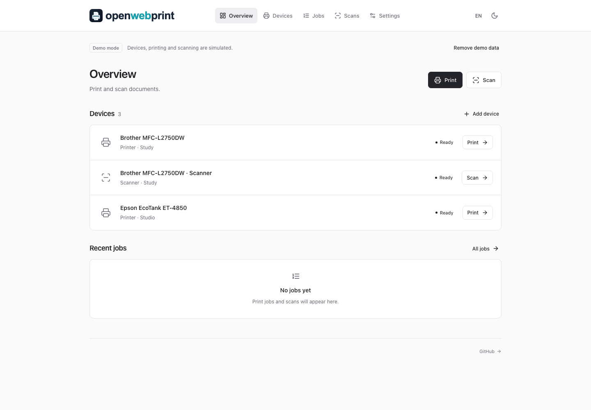
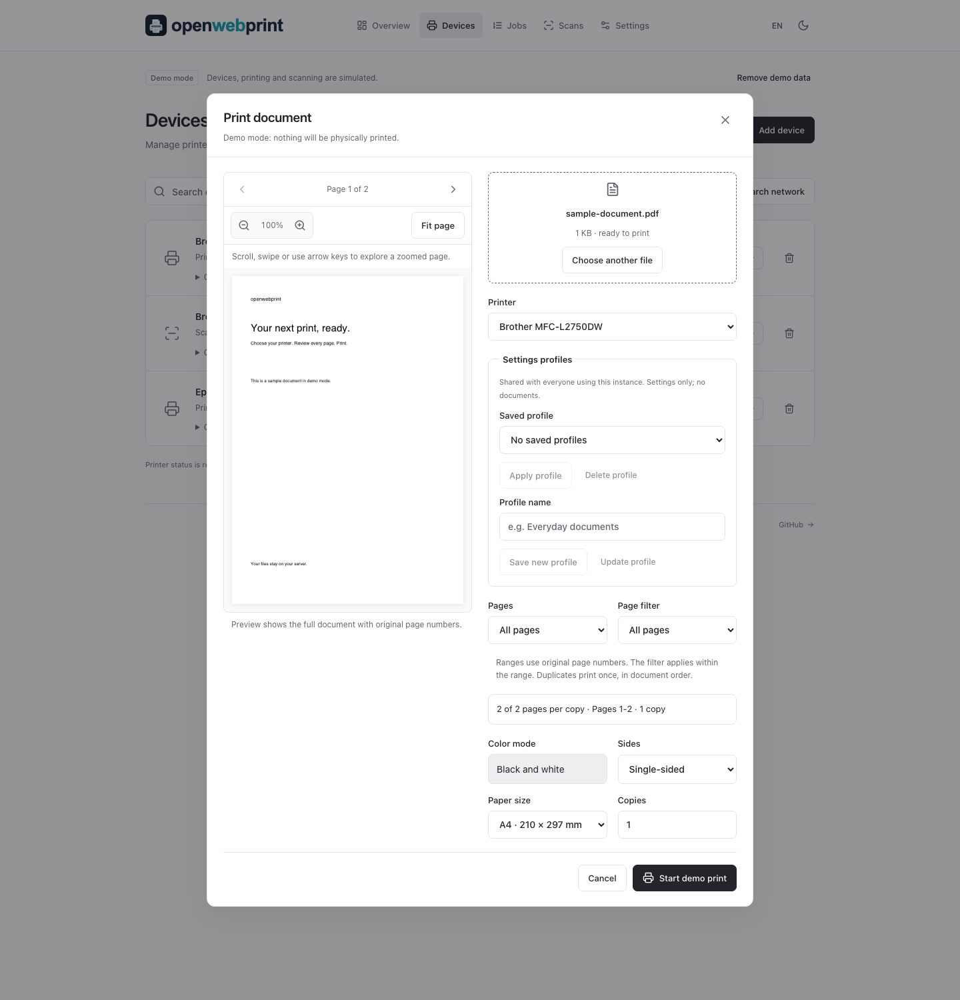
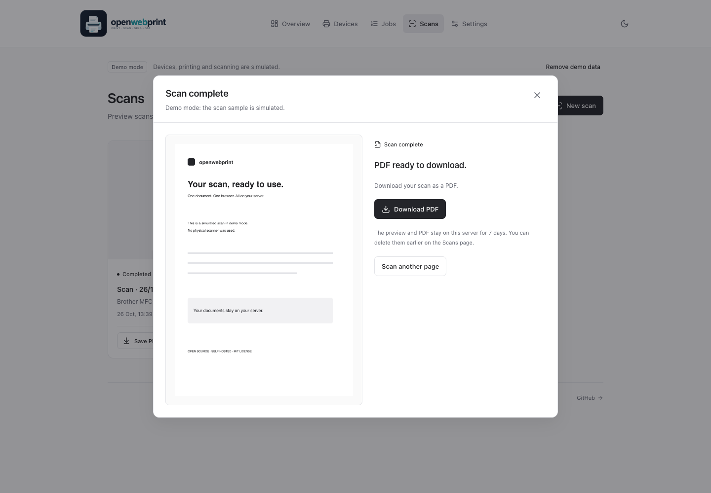
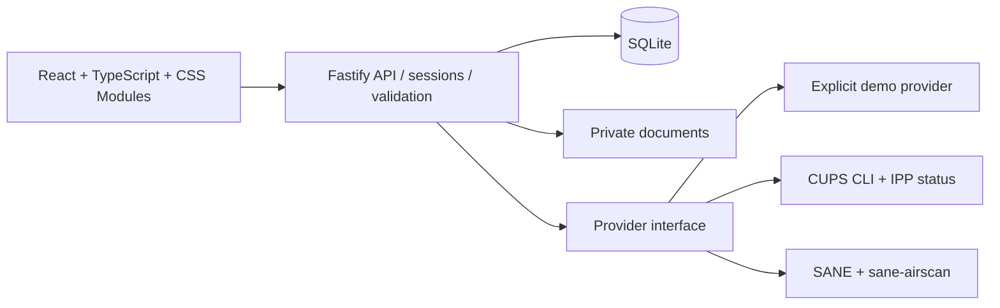

<div align="center">

<h1>
  <picture>
    <source media="(prefers-color-scheme: dark)" srcset="apps/client/public/openwebprint-logo-dark.svg" />
    
  </picture>
</h1>

**Your paper. Your workflow. Your server.**

Print and scan from your browser, without another manufacturer app.
Open source, self-hosted, and built around open standards.

[](https://github.com/Florian-Cullmann/openwebprint/actions/workflows/ci.yml)
[](LICENSE)
[](https://nodejs.org/)

[Get started](#quick-start) · [Screenshots](#screenshots) · [Self-hosting](#self-hosting) · [Brother support](docs/hardware.md#brother-from-day-one) · [Contribute](CONTRIBUTING.md)

</div>

## A calmer way to work with paper

openwebprint puts your printers, scanners, and documents in one browser workspace. No cloud account, telemetry, remote font requests, subscription, or vendor SDK. The web app and bundled hardware stack use open-source software. Some older devices may require a separately installed, potentially proprietary driver; those drivers are not bundled or required for driverless devices.

This is a working **v0.1 MVP**, with real CUPS and SANE integrations and a clearly labeled demo. Physical device compatibility still needs community testing. The interface and all application routes use English.

- **Find and connect devices:** mDNS IPP/IPPS discovery, existing CUPS queues, SANE detection, and manual setup.
- **Print documents:** validated PDF, PNG, and JPEG uploads, up to 25 MiB; copies, color, duplex, supported paper sizes, and a paginated document preview.
- **Scan a page:** 150/300/600 dpi, color or grayscale, image preview, and a real downloadable PDF.
- **Follow your work:** queued, processing, completed, canceled, failed, and explicitly unknown job states. Cancel active print jobs; delete completed records and scan files.
- **Feel at home:** responsive React interface, CSS Modules, dark/system mode, keyboard-accessible dialogs, optional user accounts, and protected sessions.
- **Develop without hardware:** deterministic demo devices including a Brother MFC-L2750DW printer/scanner pair. Demo labels remain visible throughout.

Demo print jobs never reach CUPS. Demo scans generate a sample document that explicitly identifies itself as simulated. **Hardware mode never falls back to demo behavior.**

## Screenshots

Captured from the running application with sample devices in **demo mode**. Printing and scanning are simulated; no physical device is used.

### Your workspace at a glance



Check device status, start a print or scan, and follow recent jobs from one page. **Remove demo data** clears the samples and opens the setup flow for your own devices.

### Print from your browser



Review a PDF or image before printing, browse its pages, and set printer, color, sides, paper size, and copies. Open the retained document again from Jobs after submission.

### Preview and download a scan



Review the scanned page, download its PDF, or scan another page. The sample document is clearly marked as simulated; hardware mode uses the actual scanner output.

## Quick start

Requires Node.js **24 LTS** (recommended) or 26 and npm. SQLite is provided by Node's built-in `node:sqlite`; no database service is required. Node 24 may print an experimental SQLite warning.

```sh
git clone https://github.com/Florian-Cullmann/openwebprint.git
cd openwebprint
npm ci
cp .env.example .env
npm run dev
```

Open **http://localhost:5173**. On a fresh installation, choose **Try demo** to explore simulated devices without hardware, or **Start setup** to connect your own devices. New installations have no users and do not show a login screen.

Setup searches for compatible printers and scanners, lets you choose which to connect (or add one manually), then asks for a writable scan storage folder on the server. You can continue without devices and add them later under **Devices**. Setup progress survives restarts.

To leave the demo, click **Remove demo data** in the banner. This deletes demo devices, jobs, and scan files, waits for running demo operations to finish, and opens real device discovery. Accounts and any existing hardware records are preserved. Existing configured installations keep their current mode when upgrading.

Create users under **Settings → Users** (`/settings/users`). Adding the first user enables login immediately, including for the creator. All users can manage the instance and access its devices/documents. Removing the last user disables login again. Passwords must not be empty. There are no length or character-composition requirements. Existing accounts are preserved when upgrading; legacy sessions expire once during the database migration.

### Try it with Docker

```sh
docker compose --profile demo up --build -d
docker compose logs demo
```

Open **http://localhost:3001** and choose a setup method. The port is bound to loopback by default. Stop with `docker compose --profile demo down`. Named volumes retain accounts, devices, and job history.

## Self-hosting

### Production without Docker

```sh
npm ci
npm run build
# Load your deployment configuration, then:
node --env-file=.env apps/server/dist/index.js
```

Run from the repository root: Fastify serves the compiled React app and API on the same port. In production set `APP_ORIGIN=http://localhost:3001` for local HTTP, or your actual HTTPS origin behind a reverse proxy. Do not run the Vite development server as a production server.

### Real printers and scanners

For Linux, install CUPS, SANE, and sane-airscan, then choose **Start setup** in the browser (or **Remove demo data** if you tried the demo). On Debian/Ubuntu:

```sh
sudo apt-get update
sudo apt-get install cups cups-client cups-filters sane-utils sane-airscan printer-driver-brlaser
```

The operating-system CUPS administrator must permit the application service user to manage queues, or create queues in CUPS first and import them as `cups://QUEUE_NAME`. Existing queues work without granting queue-creation rights. Do not weaken a shared CUPS server's authentication to match the dedicated container configuration.

For the bundled **Linux Docker** hardware stack:

```sh
# Stop the bridge profile first: both profiles use port 3001.
docker compose --profile demo down
docker compose --profile hardware up --build -d
docker compose logs hardware
```

The profile runs CUPS and Avahi inside the container and drops the web process to the unprivileged `node` user. It uses Linux host networking for mDNS/eSCL/WSD. Port 3001 and the dedicated CUPS scheduler (631) bind to loopback. **Do not run it alongside a host CUPS scheduler already listening on 127.0.0.1:631.** Use a native install instead, or stop the conflicting scheduler deliberately. Port 5353 may also conflict with another mDNS daemon. See [hardware networking and troubleshooting](docs/hardware.md).

The Compose profile controls **networking**, while the browser choice controls the application mode. The historically named `demo` profile uses bridge networking and can also connect manually addressed hardware. Both profiles start the hardware daemons so leaving the demo needs no container restart. They have **separate persistent data and CUPS volumes**, so changing profiles does not transfer accounts or devices. Within an instance, mode and setup progress are stored in SQLite; demo records never become real devices.

Docker Desktop on macOS/Windows does not reliably forward link-local discovery. On macOS, enable **Docker** under **System Settings → Privacy & Security → Local Network** before connecting LAN devices. If discovery remains empty, use a manual IPP address or run on a Linux host; see [Docker networking](docs/hardware.md#docker-networking). USB passthrough is not configured by the Compose file. The native app can use devices already exposed by CUPS/SANE.

For **automatic printer and eSCL scanner discovery on macOS with Docker Desktop**, run `npm run discovery:macos` on the Mac, then start Compose with `-f compose.yaml -f compose.macos.yaml --profile demo`. The optional native Bonjour helper passes current network advertisements into the container through a read-only folder. See the [macOS discovery setup](docs/hardware.md#automatic-device-discovery-with-docker-desktop-on-macos) for prerequisites, commands, and scanner limitations.

### Configuration

| Variable        | Default                 | Purpose                                                                                |
| --------------- | ----------------------- | -------------------------------------------------------------------------------------- |
| `MODE`          | unset                   | Legacy upgrade hint only; new installations choose their mode in the browser           |
| `HOST`          | `127.0.0.1`             | HTTP bind address; image defaults to `0.0.0.0`, hardware profile overrides to loopback |
| `PORT`          | `3001`                  | HTTP port                                                                              |
| `APP_ORIGIN`    | `http://localhost:5173` | Exact allowed browser origin; set to your deployed URL                                 |
| `DATA_DIR`      | `./data`                | SQLite, sessions, and private scan storage                                             |
| `COOKIE_SECURE` | `false`                 | Set `true` with HTTPS                                                                  |
| `CUPS_SERVER`   | `localhost:631`         | Local scheduler only: localhost, 127.0.0.1, or [::1], optionally with port             |

For LAN or internet access, put a reverse proxy on the same host in front of loopback port 3001, terminate TLS, set `APP_ORIGIN=https://print.example.org` and `COOKIE_SECURE=true`. The proxy must preserve the `Origin` header and allow uploads of at least 25 MiB plus multipart overhead. No CORS wildcard is used. Request limits use the direct peer IP; the app intentionally does not trust arbitrary forwarding headers. A shared proxy therefore shares rate limits.

For Docker, export those two variables or put them in the root `.env`; Compose forwards them. Other settings require updating the service environment explicitly. Do not expose CUPS or SANE to an untrusted network. With no users, everyone who can reach the web app has full access; add a user before making the app accessible beyond a trusted environment.

### Storage, backups, and access recovery

- Original uploads are normalized to private PDFs. Print PDFs are retained for **7 days** for job previews, including unconfirmed submissions, or until you delete the job. Draft previews are processed in memory and create no jobs or stored documents. CUPS has its own spool/history policy; the bundled configuration disables retained job files.
- Real scan storage defaults to `DATA_DIR/scans`. Choose an absolute server path during setup or change it under **Settings → General**. The app creates the folder and checks write access. Existing scans remain in their original location. Demo scans always use temporary instance storage.
- In Docker, paths refer to the container. `/data/scans` is covered by the named data volume. For another location, configure a bind mount and grant the `node` user write access; entering a host path alone does not mount it. Back up any external scan folders as well as `DATA_DIR`.
- Scan PNGs and PDFs remain for **7 days**, checked at startup and hourly, or until you delete them in the UI. Records remain after file expiry. Click a document title in Jobs to reopen its preview. Older print jobs created before this feature may have no retained document; already deleted files cannot be recovered.
- The UI shows the most recent **200** jobs. History is local SQLite data; it is not an analytics service.
- Back up `DATA_DIR` and your CUPS configuration while the app is stopped. For Docker, back up the named volumes. Keep backups private; scans and personal metadata are not encrypted at rest.
- Multiple users are supported, all with the same administrator permissions. To reset access, stop the server and run `node --env-file-if-exists=.env scripts/reset-access.mjs --confirm`. This removes all users and sessions, preserving devices/documents. Restart to use the instance without signing in, then add users again in Settings. With Docker, stop the service first, then run `docker compose --profile demo run --rm --entrypoint node demo scripts/reset-access.mjs --confirm` (replace `demo` with `hardware` as appropriate).

## Hardware support and honest limits

**Brother is a first-class target**, alongside HP, Canon, Epson, and other standards-compatible devices. CUPS handles printing through IPP Everywhere/AirPrint; sane-airscan handles eSCL and WSD scanning. Some Brother models support only WSD scanning. Enable the relevant protocols in the device's settings.

See the [model compatibility and troubleshooting guide](docs/hardware.md). There is no blanket promise that every model from a manufacturer works. CUPS queue state is not proof of physical reachability or paper output. `completed` means the backend reported completion; communication errors remain `unknown`, with no automatic resubmission that could duplicate prints.

Current scope:

- Collect up to 100 scanned pages in one PDF. **Scan another page** appends one page; select a scanner-advertised ADF or duplex ADF source and use **Scan multiple pages** to read a feeder batch. Rotate each page clockwise in 90° steps and reorder by dragging or with the arrow buttons; changes are saved automatically. Reopen the scan to add or edit pages. Failed follow-up scans keep the previously saved document.
- No OCR or scan cancellation. Closing the dialog leaves a scan running (up to 120 seconds for one page or 10 minutes for a batch).
- PDF uploads are rebuilt and form fields flattened before printing; annotations and document-level active content are omitted. Digital signatures are not validated.
- Standard A4, A5, and Letter print media, only when the CUPS queue reports support. Color/duplex capabilities come from IPP; scan options are backend-dependent and unsupported options fail explicitly.
- No printer firmware management, ink-level estimates, cloud relay, per-user roles or document isolation, or remote CUPS authentication.
- Jobs submitted outside openwebprint are not imported. Removing a device leaves its CUPS queue intact. CUPS history purging can make old job states unavailable.
- No physical hardware has been certified by this initial implementation. Tests cover real document generation, provider contracts, and local IPP wire fixtures; a successful demo is not a successful hardware test.

## Pages and settings

Pages have shareable URLs and support refresh and browser back/forward navigation: `/overview`, `/devices`, `/jobs`, `/scans`, `/setup` (during onboarding), and `/login` (when login is enabled). `/` redirects to `/overview`.

Settings use a horizontal menu with their own URLs:

| Category   | URL                    | Contents                                                              |
| ---------- | ---------------------- | --------------------------------------------------------------------- |
| General    | `/settings/general`    | Operating mode, scan storage, document retention, project information |
| Users      | `/settings/users`      | Add and remove users; enable or disable login by user count           |
| Appearance | `/settings/appearance` | Light, dark, or system theme                                          |
| Hardware   | `/settings/hardware`   | Brother support and driver guidance                                   |

`/settings` redirects to General. Fastify serves the React entry point for page URLs; `/api/*` remains a separate API namespace.

## Architecture



```text
apps/client/             React UI; Vite; CSS Modules
apps/server/src/         Auth, API, persistence, document processing
apps/server/src/providers/  Demo and hardware adapters; bounded execFile calls
packages/shared/        TypeScript contracts and Zod validation
e2e/                    Browser journeys and accessibility checks
docker/                 Dedicated local CUPS policy and daemon entrypoint
```

The backend uses established CUPS/SANE tools instead of implementing printer drivers. Child processes receive argument arrays with `shell: false`, validated targets, timeouts, and bounded command output. The maintained `@sealsystems/ipp` library reads CUPS capabilities and job states. Passwords use salted scrypt; only hashed session tokens are stored. HTTP-only, SameSite cookies, origin/header checks, security headers, upload validation, and rate limits protect the API. Image pixel limits and 500-page PDF limits reduce resource abuse; this is not a hardened sandbox for hostile documents. See [SECURITY.md](SECURITY.md).

## Development and verification

```sh
npm run typecheck
npm test                   # Meaningful API, security, document and provider tests
npm run build              # TypeScript checks + production frontend/backend
npx playwright install chromium
npm run test:e2e           # Desktop + mobile, real uploads/downloads, axe checks
npm audit
```

CI runs checks on Node 24/26, browser journeys on Node 24, dependency auditing, and container builds with separate demo/hardware-daemon smoke tests. The container tests also convert a synthetic PDF to PWG Raster through the installed CUPS filters, as the unprivileged web-service user. They do not claim physical hardware coverage.

Read [CONTRIBUTING.md](CONTRIBUTING.md) and [the provider guide](docs/providers.md) to add an integration or report a device. Small, focused contributions are welcome. This project is not affiliated with Brother, HP, Canon, Epson, or other hardware vendors.

## License

[MIT](LICENSE). The container includes separately licensed open-source components such as CUPS, SANE, sane-airscan, and brlaser; their licenses remain applicable. Printer names and trademarks belong to their respective owners.
