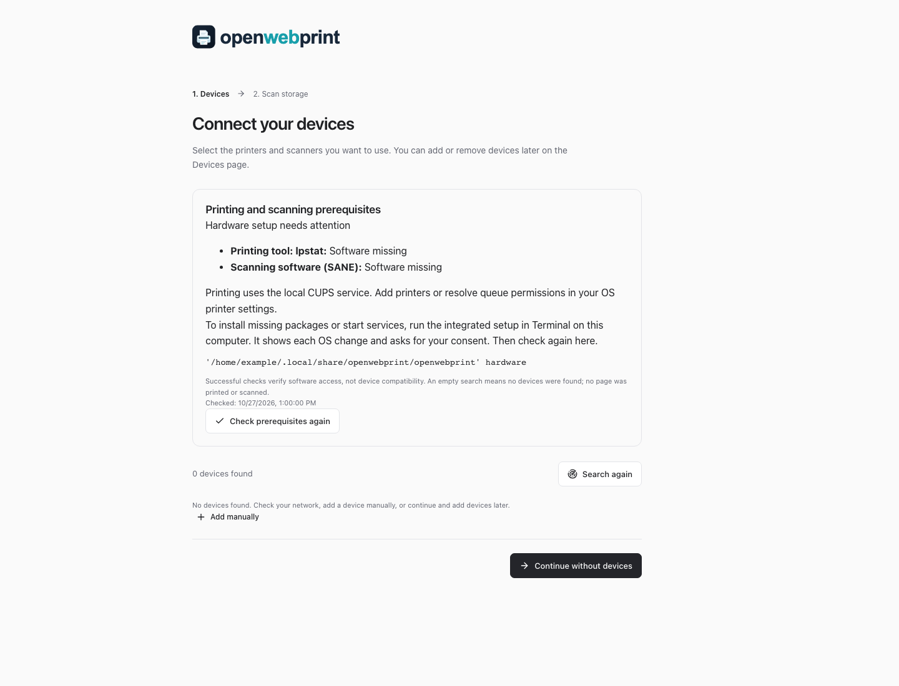

# Hardware setup validation (#72)

This records software setup evidence separately from physical device compatibility. The guided flow is unreleased (after v0.1.0-beta.2).

## Automated checks

- `node --test scripts/test-hardware-setup.mjs`: controlled Linux/macOS command and OS fixtures cover absent/present tools, healthy empty discovery, stopped CUPS (including exit 0), permission errors, timeouts, consent refusal, package failure and successful repair. A real child-process boundary tests missing executables, timeout termination and redaction. No packages/services are changed by these fixture tests.
- `npm test`: includes hardware API authentication/origin protection, concurrent-check coalescing, retry and isolation from snapshot polling; existing CUPS/SANE provider tests remain hardware fixtures.
- `npx playwright test e2e/hardware-prerequisites.spec.ts e2e/workflow.spec.ts`: production onboarding on desktop/mobile, controlled API results for missing dependencies and successful repair, accessible results, no native-install Docker advice, no horizontal overflow, and continuation without devices.
- `npm run test:install`: release archive/private runtime/application lifecycle checks. The first install performs actual noninteractive prerequisite probes and verifies that software readiness and application startup are reported separately. Repeated lifecycle operations skip probes explicitly. No OS changes are authorized by this smoke test.
- Installer CI runs the fixture and package smoke tests on Linux x64/arm64 and macOS Intel/Apple Silicon. A separate explicitly opted-in hardware setup step installs real dependencies and starts services in each disposable runner, then rechecks tools/service readiness. Its output is software evidence, not device certification.

## Local verification

Development host: macOS Apple Silicon. Production build and automated checks run locally. The 12 installer fixture checks also pass in a disposable Linux Node 24 container; this does not exercise a real systemd installation. A read-only system CUPS check reproduced localized output despite `LANG=C`; setting `SOFTWARE=openwebprint` makes macOS CUPS honor the fixed locale. No host packages, CUPS queues, service configuration or permissions were changed. A disposable Linux container also passed the production Docker build, real CUPS/SANE prerequisite API, hardware API smoke test and CUPS PDF-to-PWG-Raster filter check; this performs no physical printing.

The screenshot below shows the actual onboarding UI with controlled missing-software API results, not a physical discovery result:

## Physical hardware

**Not performed for this change.** Neither a passing prerequisite check nor demo printing/scanning certifies a device. Before recording a physical compatibility result, record the OS, installation method/release, device model/firmware, backend, a real printed page and an acquired scan, and any remaining driver/permission requirement. Do not include private documents, device addresses or raw stderr in public evidence.
